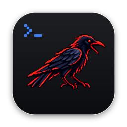

<!-- Copyright 2026 Federico Cesarini, Marco Sassarini. SPDX-License-Identifier: AGPL-3.0-or-later -->
<!-- Written by Crow Harness's release workflow at every release: edits made here are overwritten. -->

<h1 align="center">Crow Harness: one box for all your Claude Code sessions</h1>

<b>A desktop app for macOS, Windows and Linux.</b> 
Type in one box: Crow Harness sends the message to the right Claude Code session, in a real terminal window, 
or starts a new one. Every session shares one memory, and Telegram reaches them from your phone.

  <a href="#download"><b>Download Crow Harness 0.1.3</b></a> ·
  <a href="#install-the-builds-are-not-signed-yet">Install help</a> ·
  <a href="#what-you-need">What you need</a>

---

**Your Claude Code sessions live in folders and conversation ids: to pick up some work you open a terminal in the right
folder and resume the right conversation. Crow Harness removes that.** You type what you want; a small router model
reads your recent sessions and picks the one the message belongs to, resumes it in a window of the app, and types the
message in. A message that fits nothing starts a new session in the folder you choose.

## What it does

- **Routes every message.** Jev, a classifier on [OpenRouter](https://openrouter.ai), compares the message with your 30
  most recent Claude Code sessions, in any folder. When it is sure the message flies into that session's window; when
  it isn't, the best matches show as buttons above the box. Messages that start with `/` go to the active window.
- **Real Claude Code, in windows.** Each window is the official interactive `claude` terminal, with your own login. The
  windows tile the screen side by side: drag the gaps to resize, drag a window onto another to swap them, double-click
  a header to enlarge it. The window you used last is a little bigger.
- **You choose how it asks.** The top bar sets the permission mode, **Manual**, **Auto** or **Skip permissions**, and
  **Code Mode** for new sessions. Each window shows the mode it runs in.
- **One memory for every session.** Each session gets a shared brain (the open-source
  [llm-wiki-v2](https://github.com/crow-hq/llm-wiki-v2) engine) with `remember`, `recall`, `search` and `read_note`:
  a fix found in one project is there for the next. The brain map shows the notes and the sessions that wrote them.
- **Telegram and voice.** Connect a Telegram bot in a few guided steps, then send text or voice notes from your phone;
  replies come back naming the session. In the app, press Send while recording and your voice is transcribed and sent.
- **Stays out of your setup.** Sessions get the hooks and the memory only through per-launch flags. The one change to
  `~/.claude` is the optional brain instructions in `CLAUDE.md`, and only if you choose them.

## What you need

- **[Claude Code](https://docs.claude.com/en/docs/claude-code), installed and signed in** (the `claude` command, with
  your own plan). The first run checks it and can install it or sign you in. On Windows, Claude Code also needs
  [Git for Windows](https://git-scm.com/download/win).
- **An [OpenRouter](https://openrouter.ai) account**, for the router, the memory model and voice transcription. You sign
  in from the app; a monthly spending cap ($10 by default) stops everything at the limit. Routing costs a fraction of a
  cent per message.
- macOS 12 or later, Windows 10 or 11 (64-bit), or a 64-bit Linux with a desktop.

## Download

Crow Harness 0.1.3, released 28 November 2026:

| System | For | Download | Size |
|---|---|---|---|
| **macOS** | Apple silicon (M1 and later) | [Crow-Harness_0.1.3_aarch64.dmg](https://github.com/crow-hq/crow-harness-desktop/releases/download/v0.1.3/Crow-Harness_0.1.3_aarch64.dmg) | 32 MB |
| **macOS** | Intel | [Crow-Harness_0.1.3_x64.dmg](https://github.com/crow-hq/crow-harness-desktop/releases/download/v0.1.3/Crow-Harness_0.1.3_x64.dmg) | 34 MB |
| **Windows** | Installer (.exe) | [Crow-Harness_0.1.3_x64-setup.exe](https://github.com/crow-hq/crow-harness-desktop/releases/download/v0.1.3/Crow-Harness_0.1.3_x64-setup.exe) | 34 MB |
| **Windows** | Installer for IT (.msi) | [Crow-Harness_0.1.3_x64_en-US.msi](https://github.com/crow-hq/crow-harness-desktop/releases/download/v0.1.3/Crow-Harness_0.1.3_x64_en-US.msi) | 35 MB |
| **Linux** | AppImage, any distribution | [Crow-Harness_0.1.3_amd64.AppImage](https://github.com/crow-hq/crow-harness-desktop/releases/download/v0.1.3/Crow-Harness_0.1.3_amd64.AppImage) | 119 MB |
| **Linux** | Debian, Ubuntu (.deb) | [Crow-Harness_0.1.3_amd64.deb](https://github.com/crow-hq/crow-harness-desktop/releases/download/v0.1.3/Crow-Harness_0.1.3_amd64.deb) | 40 MB |
| **Linux** | Fedora, openSUSE (.rpm) | [Crow-Harness-0.1.3-1.x86_64.rpm](https://github.com/crow-hq/crow-harness-desktop/releases/download/v0.1.3/Crow-Harness-0.1.3-1.x86_64.rpm) | 40 MB |

Every file of this version is on its [release page](https://github.com/crow-hq/crow-harness-desktop/releases/tag/v0.1.3); older versions are under
[Releases](https://github.com/crow-hq/crow-harness-desktop/releases).

## Install (the builds are not signed yet)

The installers are not signed with an Apple or Microsoft developer certificate yet, so macOS and Windows warn you the
first time. You do this once.

### macOS

1. Open the `.dmg` (aarch64 for Macs with M1 or later, x64 for Intel) and drag **Crow Harness** into **Applications**.
2. Open it. When macOS says it could not verify it, click **Done**.
3. Open **System Settings → Privacy & Security**, scroll to **Security**, click **Open Anyway** next to *"Crow Harness"
   was blocked*, and confirm. From then on it opens with a double-click.

If macOS says the app "is damaged and can't be opened", run
`xattr -dr com.apple.quarantine "/Applications/Crow Harness.app"` in Terminal and open it again.

### Windows

1. Download `Crow-Harness_…_x64-setup.exe`. If the browser says it isn't commonly downloaded, choose **Keep**.
2. Run it. When Microsoft Defender SmartScreen says *Windows protected your PC*, click **More info → Run anyway**.

### Linux

- **AppImage**, any distribution: `chmod +x Crow-Harness_*.AppImage`, then run it. If it mentions FUSE:
  `sudo apt install libfuse2t64` (Ubuntu 24.04 and later) or `libfuse2` (22.04).
- **Debian, Ubuntu:** `sudo apt install ./Crow-Harness_*_amd64.deb`
- **Fedora, openSUSE:** `sudo dnf install ./Crow-Harness-*.x86_64.rpm`

The native folder picker uses `zenity` or `kdialog`, which most desktops have.

## Start

1. **Claude Code:** the app checks that `claude` is installed and signed in, and can fix either in a small terminal.
2. **OpenRouter:** press Connect and sign in; the app gets a key of its own on your account (or paste a key).
3. **Memory:** pick the model that writes the shared brain (DeepSeek V4.1 Flash by default).
4. **Teach Claude Code to use the brain** (optional): a few lines added to your `~/.claude/CLAUDE.md`, shown before
   anything is written, so every Claude Code session, also those you start in a terminal, saves what matters in the
   brain and looks there first. Settings → Claude Code removes them.
5. **Spending cap:** monthly, $10 by default.

Then type what you are working on. Telegram is set up later, from the top bar's **Telegram** button.

## Your data

Everything stays on your computer, in `~/Library/Application Support/Crow Harness` (macOS),
`%LOCALAPPDATA%\Crow Harness` (Windows) or `~/.local/share/Crow Harness` (Linux). What goes to OpenRouter: a short,
redacted description of your recent sessions and the message (for routing), what the sessions ask the memory to keep
(to file it), and voice recordings (to transcribe them). Keys, tokens and private keys are removed before anything is
sent. Your Claude Code sessions talk to Anthropic as they always do.

## Something wrong?

- **Bugs and ideas:** [issues](https://github.com/crow-hq/crow-harness-desktop/issues).
- **Logs:** the `logs` folder inside the data folder above.

## Credits and license

Crow Harness is by Federico Cesarini and Marco Sassarini, the authors of [Crow](https://github.com/crow-hq/crow-desktop)
and [llm-wiki-v2](https://github.com/crow-hq/llm-wiki-v2). It is licensed under the GNU AGPL v3.0 or later; every
installer carries the licence and the notices of the components it ships. Claude Code is Anthropic's; Crow Harness
drives it with your own login and is not affiliated with Anthropic.
